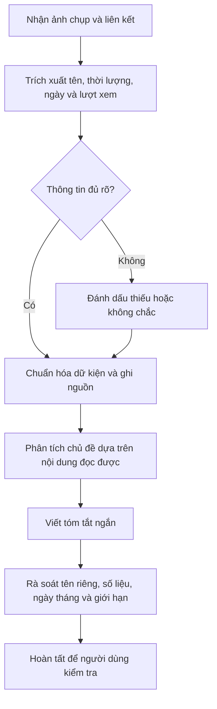

# Trợ lý tóm tắt nội dung truyền thông

> Dự án mẫu về cách tiếp nhận thông tin từ ảnh chụp và liên kết video, chuẩn hóa dữ kiện, nhận diện chủ đề, rồi viết bản tóm tắt có ghi nguồn và giới hạn kiểm chứng.

**Website showcase:** [https://huongnguyen-jpg.github.io/media-content-summary-assistant/](https://huongnguyen-jpg.github.io/media-content-summary-assistant/) · **Mã nguồn:** [GitHub repository](https://github.com/HuongNguyen-jpg/media-content-summary-assistant)

## Mục tiêu

Trình bày một quy trình hỗ trợ học tập có thể áp dụng cho video âm nhạc và nội dung giải trí. Kết quả cần dễ đọc, nêu rõ nguồn, và phân biệt thông tin người dùng cung cấp với thông tin đã kiểm chứng độc lập.

## Quy trình

## Ví dụ trong tài liệu

- **Âm nhạc:** video lời bài hát “I Do” của 911, có phụ đề tiếng Việt; phần tóm tắt nêu chủ đề tình yêu, lời hứa và song ngữ. Nguồn video được ghi trong ảnh người dùng cung cấp: [YouTube](https://youtu.be/7o5XAg_EeLW).
- **Giải trí:** ảnh chụp ghi lại một bản tóm tắt trailer chương trình *Running Man Vietnam 2026*. Các ngày phát sóng và số liệu trong ảnh được xem là dữ liệu trong ảnh, chưa được xác minh độc lập.

## Giới hạn

- Nội dung trong ví dụ được tổng hợp từ ảnh chụp do người dùng cung cấp; repo này không xác nhận độc lập các số liệu, ngày phát sóng hay tuyên bố trong ảnh.
- Không chép lời bài hát hoặc toàn bộ nội dung video. Chỉ mô tả chủ đề ở mức khái quát.
- Khi ảnh mờ hoặc nguồn không truy cập được, cần ghi rõ điều đó và giới hạn phần kết luận.
- Người dùng cần rà soát kết quả trước khi nộp hoặc chia sẻ.

## Cấu trúc

- `README.md`: mục tiêu, quy trình và giới hạn của dự án.
- `examples.md`: mô tả hai ví dụ được thể hiện trong ảnh.
- `index.html`: website showcase song ngữ Việt–Trung với ví dụ tương tác.

## Ngôn ngữ

README này viết bằng tiếng Việt để tiện gửi giáo viên. Ảnh tham khảo ban đầu có nội dung tiếng Trung và tiếng Việt.
